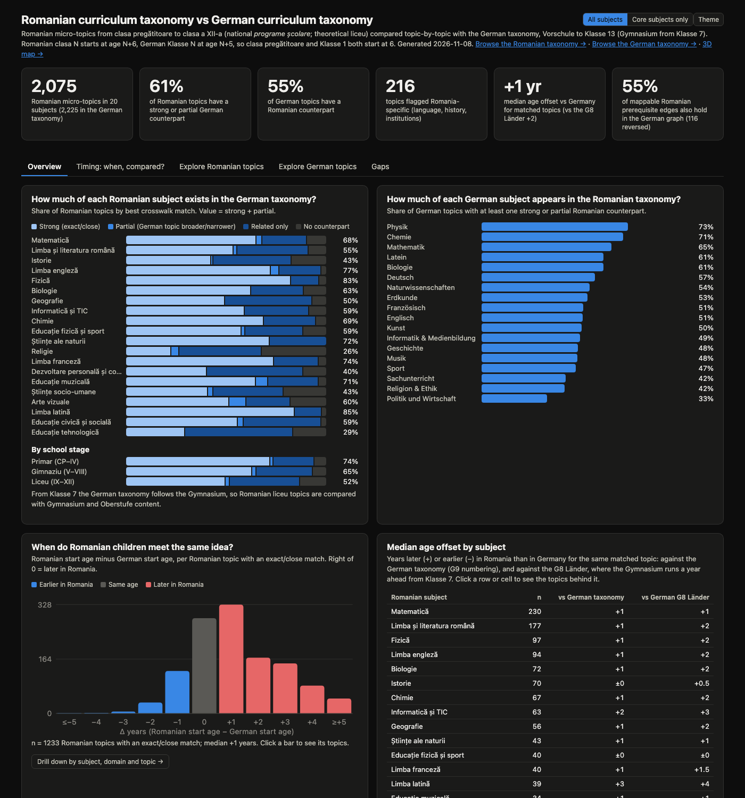

# Romanian vs German curriculum taxonomy: comparison

*2026-11-09 · Romanian taxonomy `ro-v1` (2,075 topics, clasa pregătitoare to clasa a XII-a,
theoretical liceu) vs German taxonomy `de-v2` (2,225 topics, Vorschule to Klasse 13,
Gymnasium from Klasse 7). Interactive explorer: `index.html`, built with
`cd ../ro-taxonomy && npm run all` (opens offline; deep links like `index.html#ro/<key>`,
`#de/<key>` or `#timing`).*
- **Timing tab:** how much earlier or later Romanian children meet the same idea, against the German taxonomy or against the German Länder that run the Gymnasium a year ahead (G8). Filter by school stage, subject, domain or offset; open any pair to see both descriptions.
- **Core subjects only** (top right, or `index.html?subjects=core`): recomputes every number for the core subjects of both countries.
- **English, Deutsch, Română** (top right, or `index.html?lang=de` / `?lang=ro`): the whole page, including topic names and descriptions, in English, German or Romanian.

*Every number below is in [`generated-tables.md`](generated-tables.md) and
[`comparison.json`](comparison.json), produced by `ro-taxonomy/scripts/compare.mjs`. The
Romanian taxonomy is browsable at `../ro-taxonomy/index.html`, both as a 3D map at
`../de-taxonomy/graph.html#ro`.*

## Headline findings

1. **Most of what Romanian children learn has a German counterpart.** 61% of Romanian
   topics (1,263 of 2,075) have a strong or partial German match; another 30% are only
   related, and 9.5% (197) have none. The other way, 55% of German topics have a Romanian
   counterpart.
2. **The overlap shrinks with age.** Primar 74%, gimnaziu 65%, liceu 52%. On the German side,
   the Oberstufe is the least covered (39%). The upper years are where national content
   (literature, history), the choice of specialisation and exam traditions diverge.
3. **Same age at the start, about a year later from clasa a III-a.** Both countries start
   school at 6 (clasa pregătitoare = Klasse 1). For the 1,233 Romanian topics with an exact or
   close match, the median offset is **+1 year** (63% later, 23% same age, 14% earlier).
   CP–II: 0. Clasele III–VIII and liceu: +1. Exact matches alone (n = 271) give the same +1.
   Against the G8 Länder, where the Gymnasium is a year ahead from Klasse 7, it is +2 from
   clasa a VII-a.
4. **Some things come clearly earlier in Romania**: atomic structure, ions and the mole
   (VII vs Kl. 9), powers and Pythagoras (V–VI vs Kl. 8–9), the separation of powers (VII vs
   Kl. 11), English from clasa pregătitoare (vs Kl. 3 in most Länder), text-based programming
   (VII), and in matematică-informatică an informatics course years ahead of the Oberstufe
   (complexity in IX, recursion in X, graphs and backtracking in XI).
5. **Others come much later**: word formation and word families (V–VII vs Kl. 2–4), the
   literary genres (VIII vs Kl. 2), Latin (one year in VII, then only in the humanities), and
   the basics of IT and online safety.
6. **The two graphs mostly agree on order.** Of 1,824 Romanian prerequisite pairs whose two
   ends map onto German topics, 55% also hold in the German graph, 6% (116) are reversed and
   the rest are unrelated there or map to the same German topic.

## Coverage both ways

| Romanian stage | Topics | Strong (exact/close) | Partial | Related only | None | Strong + partial |
|---|---:|---:|---:|---:|---:|---:|
| Primar (CP–IV) | 413 | 300 | 5 | 83 | 25 | 74% |
| Gimnaziu (V–VIII) | 744 | 473 | 11 | 209 | 51 | 65% |
| Liceu (IX–XII) | 918 | 460 | 14 | 323 | 121 | 52% |
| **All** | **2,075** | **1,233** | **30** | **615** | **197** | **61%** |
| Core subjects only | 1,670 | 1,000 | 20 | 489 | 161 | 61% |

| German stage | Topics | With a Romanian counterpart |
|---|---:|---:|
| Grundschule (Vorschule–Kl. 4) | 632 | 55% |
| Sek I (Kl. 5–10) | 1,094 | 62% |
| Oberstufe (Kl. 11–13) | 499 | 39% |

**Best covered Romanian subjects:** Latin 85%, physics 83%, English 77%, French 74%,
primary science 72%, music 71%, chemistry 69%, maths 68%. **Least:** religion 26%,
technology education 29%, personal development 40%, social sciences 43%, history 43%,
geography 50%.

**German content with no Romanian counterpart at all:** traffic and cycling
(*Mobilität und Verkehr*), swimming, formal languages and automata, reflecting on media and
technology (*Analysieren und Reflektieren*), globalisation and development, the Weimar
Republic, sports science, and practical art presentation.

**Romanian content with no German counterpart:** Romanian spelling rules (â/î, the hyphen,
i/ii/iii), the history of the Romanians and of the Romanian language, Orthodox doctrine and
saints, sets and progressions, complex numbers, determinants, groups and conics in liceu
maths, formal logic (syllogisms, the logical square), the digit and divisibility algorithms
of Romanian informatics, natural-hazard drills, and a separate subject for personal
development and career guidance from clasa pregătitoare.

## When do Romanian children meet the same idea?

| Romanian stage | n | Median Δ vs German taxonomy | vs G8 Länder |
|---|---:|---:|---:|
| CP–II | 161 | 0 | 0 |
| Clasele III–IV | 139 | +1 | +1 |
| Clasele V–VI | 246 | +1 | +1 |
| Clasele VII–VIII | 227 | +1 | +2 |
| Liceu (IX–XII) | 460 | +1 | +2 |
| **All** | **1,233** | **+1** | **+2** |

Δ = Romanian start age (clasa + 6) minus German start age (Klasse + 5); positive = later in
Romania. Because both school systems start at 6, a year of age is also a year of school.

By subject the median is **+1** for maths, Romanian/German, physics, English, biology,
chemistry, geography, primary science, French, music, art, civic education and the social
sciences; **0** for history and PE; **+2** for informatics and personal development; **+3**
for Latin, religion and technology education.

## Subject notes

- **Maths.** Romania front-loads algebra and geometry (powers in V, Pythagoras in VI, solid
  geometry with dihedral angles in VIII) and has more pure algebra in liceu (complex numbers,
  matrices, determinants, groups, polynomials). Germany goes further in stochastics
  (distributions, hypothesis tests) and in primary data and chance; the new Romanian liceu
  programmes have dropped vectors. False friend: *teorema lui Thales* is the Strahlensatz.
- **Romanian / German.** Grammar is intuitive until clasa a IV-a, then far more explicit than
  in German (full clause analysis by VIII). Literature is taught in national chronological
  order in liceu; German *Sprachreflexion* (sign models, language acquisition) has no
  counterpart, while Romania adds argumentation, functional styles and evaluating AI text.
- **Sciences.** Chemistry and physics start formal content early (VII–VIII). In liceu all
  four specialisations start with vector mechanics; the humanities stop the sciences after X.
  In the lower secondary years Germany has more astronomy, radioactivity and sex education.
- **History and geography.** A whole year (VIII) on the history of the Romanians, compulsory
  courses on the Holocaust (XI) and communism (XII); geography goes continent by continent and
  ends with Romania, where German Erdkunde is organised by themes.
- **Languages and IT.** English starts in clasa pregătitoare and aims at A2+ by VIII (German
  MSA: B1 at Kl. 10). Latin is about Latin roots of Romanian, not reading texts, until the
  humanities read Caesar, Cicero and Vergil. IT is compulsory from V and half programming.
- **Arts, sport, religion, personal development.** Arts end in clasa a X-a; swimming is
  optional; religion is confessional (Orthodox here), where German Religion & Ethik compares
  religions and teaches philosophy; personal development and career guidance run as a subject
  through all twelve years.

## How the two systems are organised

| | Romania | Germany (this taxonomy) |
|---|---|---|
| Curriculum | One national set of programmes | 16 Länder curricula under KMK standards |
| School start | Clasa pregătitoare at 6 | Klasse 1 at 6 (Vorschule at 5) |
| Track modelled | Common school to VIII, theoretical liceu IX–XII | Grundschule to 4, Gymnasium from Klasse 7, G9 Oberstufe |
| Upper-school choice | Specialisation (MI, SN, SS, FIL) fixed at entry | Course levels (gA/eA) chosen per subject |
| Exams | Evaluarea Națională (VIII), Bacalaureat (XII) | Abitur (Klasse 13) |
| Topics, subjects | 2,075 in 20 subjects | 2,225 in 18 subjects |
| Prerequisite edges per topic | 1.85 (max depth 43) | 2.03 (max depth 50) |
| Cross-subject edges | 11% | 14% |
| Standards | 2,731 official competence codes in 88 programmes | 4,619 codes in 107 sources |

## Method

- **Crosswalk.** Every Romanian topic was matched to 0–4 German topics by the authoring
  passes, from candidate lists ranked by text search (`ro-taxonomy/tools/de-candidates.mjs`),
  with a relation from the Romanian topic's point of view (exact, close, broader, narrower,
  related). Matching is on content, not grade. 2,909 links: 273 exact, 1,129 close, 44
  broader/narrower, 1,463 related.
- **Coverage.** A topic counts as covered when its best link is exact, close, broader or
  narrower; "related only" is reported separately.
- **Timing.** One pair per Romanian topic with an exact or close match (the best relation,
  then the smallest age gap). The G8 variant subtracts a year from German topics starting in
  Klasse 7 or later.
- **Prerequisite agreement.** For each Romanian edge a ← b where both ends map onto German
  topics A, B, check whether B is an ancestor of A in the German graph.
- **Core subjects.** The core variant drops French, Latin, the arts, PE, religion,
  technology and personal development on the Romanian side and Französisch, Latein, Musik,
  Kunst, Sport and Religion & Ethik on the German side.

## Limitations

- **Two AI-authored taxonomies.** Neither has been reviewed by teachers; the crosswalk is a
  judgement layered on both.
- **Different tracks after primary school.** From Klasse 7 the German taxonomy describes the
  Gymnasium, a selective track, while Romanian clasele V–VIII are the common school for all
  pupils; part of the +1 year in V–VIII may be that difference rather than pace.
- **"Close" pairs can span very different depths.** A Romanian liceu topic may be matched to
  a German primary topic on the same idea (e.g. reading diagrams critically, +8 years). The
  exact-only median (+1) is the more robust number.
- **Liceu in transition.** The Romanian liceu side follows programmes that only reach
  clasa a XII-a in 2029–2030, partly from drafts (see `ro-taxonomy/PROVENANCE.md`).
- **German Länder vary**; the German side uses typical placement in G9 numbering.
