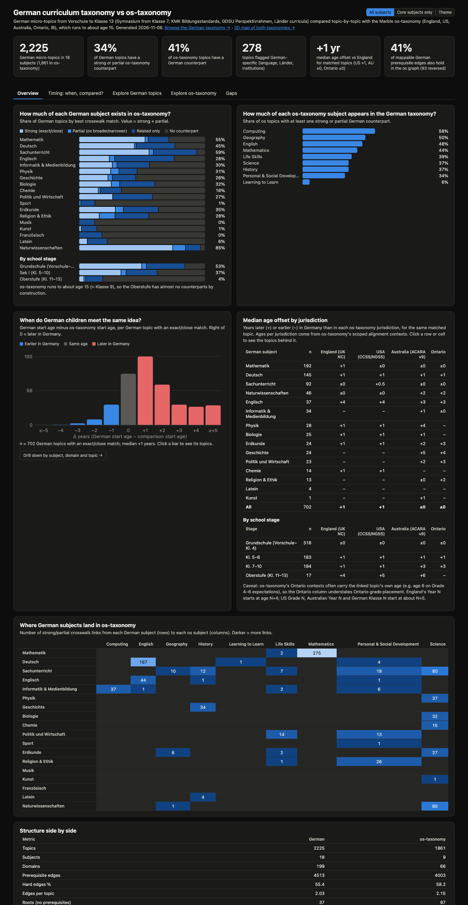

# German curriculum taxonomy vs os-taxonomy: comparison

*2026-11-06 · German taxonomy `de-v2` (2,225 topics, Vorschule to Klasse 13, Gymnasium
from Klasse 7) vs Marble os-taxonomy `v1` (1,861 topics, ages 4–15). Interactive
explorer: [online](https://codingarchitect-wq.com/lernlandkarte/comparison/index.html), or
`index.html`, built with `cd ../de-taxonomy && npm run all` (opens offline; deep links like
`index.html#de/ma-zo-bruchbegriff`, `#os/mt_N8CpN1EJrP` or `#timing`).
- **Timing tab:** drills into the age offsets. Compare with os-taxonomy overall or with England, the US, Australia or Ontario. Filter by school stage, subject, domain or offset, and open any topic pair to see both descriptions and the start age in every jurisdiction.
- **Core subjects only** (top right, or `index.html?subjects=core`): recomputes every number without Französisch, Latein, Musik, Kunst, Sport and Religion & Ethik.
- **English, Deutsch, Română** (top right, or `index.html?lang=de` / `?lang=ro`): the whole page, including topic names and descriptions, in English, German or Romanian. os-taxonomy topics stay in English.

The German taxonomy itself is browsable
[online](https://codingarchitect-wq.com/lernlandkarte/de-taxonomy/index.html), and both
taxonomies as a [3D map](https://codingarchitect-wq.com/lernlandkarte/de-taxonomy/graph.html);
the same build writes them locally to `../de-taxonomy/`.
Every number below is in [`generated-tables.md`](generated-tables.md) and
[`comparison.json`](comparison.json), produced by `de-taxonomy/scripts/compare.mjs`.*

## Headline findings

1. **Overlap is high in primary school and falls with age, partly by construction.**
   34% of German topics have a strong or partial os-taxonomy counterpart, 24% have
   only a loosely related one, and 42% (930 topics) have none. By stage:

   | Stage | German topics | With a strong or partial os counterpart |
   |---|---:|---:|
   | Grundschule (Vorschule–Klasse 4) | 632 | 53% |
   | Sek I (Klasse 5–10) | 1,094 | 37% |
   | Oberstufe (Klasse 11–13) | 499 | 4% |

   os-taxonomy stops at about age 15 (≈ Klasse 9), so the Oberstufe can hardly match.
   - **Core subjects only:** the overall figure is 42%.
   - **By subject:**
     - Mathematik: 76% in the Grundschule, 94% in Klasse 5–6, 46% in Klasse 7–10, 0% in the Oberstufe.
     - Klasse 5–6 Naturwissenschaften: 85%.
     - Biologie and Physik: about half of their Klasse 7–10 topics.
     - Chemie: 30% of its Klasse 7–10 topics.
   - **Near zero:** Musik, Französisch, Sport, Kunst and Latein (0–6%), because os-taxonomy has no arts, PE or foreign-language topics.
2. **Germany has subjects os-taxonomy doesn't.** It has 18 subjects to os's 9:
   - **missing from os:** Music, Art, PE, two foreign languages beyond English (Französisch, Latein), Religion/Ethics/Philosophy;
   - **taught as separate subjects in Germany:** Biologie, Chemie and Physik from Klasse 7;
   - **integrated:** Sachunterricht in Klassen 1–4, which os spreads across Science (80 links), PSD (18), History (12), Geography (10) and Life Skills (7).
3. **German children meet the same idea at the same age in primary school, then about
   a year later.** Across 702 strongly matched topics, the median German start age is
   **+1 year vs England**, **+1 vs the US** and **±0 vs Australia**. Counting only
   exact matches (n = 88) gives +1 England, 0 US, 0 Australia. By stage:

   | Stage | n | vs England | vs US | vs Australia |
   |---|---:|---:|---:|---:|
   | Grundschule | 318 | ±0 | ±0 | ±0 |
   | Klasse 5–6 | 183 | +1 | +1 | +1 |
   | Klasse 7–10 | 184 | +1 | +1 | +3 (n = 47) |
   | Oberstufe | 17 | +4 | +5 | – |

   English children start school a year earlier, so "±0 vs England" in primary school
   means German children are a school year behind in grade terms but the same age.
   From Klasse 5, the Gymnasium introduces the same ideas about a year later than
   the os-taxonomy jurisdictions, usually in more depth.
4. **Clearly later in Germany** (median offset of the subject's matched topics):

   | Area | Germany | Median |
   |---|---|---|
   | English grammar and writing (a *foreign* language) | Klasse 3–13 | +4 to +5 |
   | Ancient history (Egypt, Greece, Rome), with source criticism | Klasse 6 | +4 |
   | History from Klasse 7 (historians' interpretations, multiple perspectives) | Klasse 7–13 | +4 |
   | Economics and civics (supply and demand, starting a business, socialisation) | Klasse 5–13 | +3 to +4 |
   | Deutsch from Klasse 7 (argumentative essay, characterisation, analysis) | Klasse 7–13 | +3 |
   | Erdkunde from Klasse 7 | Klasse 7–13 | +3 |
   | Fractions as a concept | Klasse 5–6; only ½ kg or a three-quarter hour in primary school | halves and quarters from age 5–6 |

   Mathematik, Physik and Chemie from Klasse 7 are close to os-taxonomy (median +1).
   Many large single offsets (+6 to +9) pair an early, simple os topic with a later,
   deeper German one. For example, "expressing opinions" at age 4 vs discussing
   opinions in English as a foreign language in Klasse 8. See the Limitations.
5. **Some areas are clearly earlier in Germany:**

   | Topic | Germany | os-taxonomy |
   |---|---|---|
   | Renewable vs finite energy | Klasse 3 | age 12 |
   | Binary codes | Klasse 2 | age 10 |
   | Views of solids | Klasse 2 | age 10 |
   | Systematic counting of possibilities | Klasse 2 | age 10 |
   | Tessellations | Klasse 3 | age 11 |
   | Lab reports | Klasse 5 | age 13 |
   | Division with remainder | Klasse 2 | age 9 |
   | Touch-typing | Klasse 2 | age 9 |
   | Pollination | Klasse 5 | age 12 |
   | Smoking and addiction prevention | Klasse 6 | age 13 |

   Sachunterricht also covers civic participation (class council, class
   representative elections, children's rights, the municipality) in Klassen 3–4,
   and age-appropriate sex education from Klasse 1.
6. **278 topics are flagged German-specific** (139 of them from Klasse 7). These are things an os-based product would miss or get wrong for a child in a German school.

   **Primary school**
   - **German language:** grammatical gender, the four cases, verb-second word order and the sentence bracket, nouns written with a capital letter, final-consonant devoicing (and the *Verlängern* strategy), s/ss/ß.
   - **Maths formats:** *Rechendreiecke*, *Zahlenmauern*, "halb drei" meaning 2:30, the number-word inversion (*dreiundzwanzig*), the *Ergänzungsverfahren* method of written subtraction.
   - **Road safety and swimming:** cycling training and the cycling test, the Seepferdchen badge; later the Silber/Gold and lifeguard (Rettungsschwimmer) badges.

   **Gymnasium**
   - **Deutsch:** Konjunktiv I and reported speech, the Feldermodell, comma rules, the Novelle and Kurzgeschichte, and the literary Epochen from Barock, Sturm und Drang and Weimarer Klassik to Exilliteratur, Gruppe 47 and literature in East and West Germany.
   - **Geschichte:**
     - the Reich and the Investiture Controversy, the Reformation and the Thirty Years' War;
     - Reichsgründung 1871, the Kaiserreich, and German colonial rule and the genocide of the Herero and Nama;
     - Weimar, the NS dictatorship, and the GDR and reunification.
   - **Politik und Wirtschaft:** the Grundgesetz (Article 20, Grundrechte), Bundestag, Bundesrat and Bundesverfassungsgericht, the electoral system, Tarifautonomie and co-determination, the dual vocational training system, wehrhafte Demokratie.
   - **Erdkunde:** the Energiewende, structural change, demographic change and Christaller's central places.
   - **Foreign languages:** mediation from German into English and French, Franco-German friendship, the Latinum, and Romans in Germania.
   - **Other subjects:** religion and the state in Germany (church tax, religious education), the Youth Protection Act, "Entartete Kunst", copyright and GEMA.
7. **Most os-taxonomy content appears somewhere in the German taxonomy.** 41% of os
   topics have a German counterpart, up from 31% when the taxonomy stopped at Klasse 6.
   - **By os start age:** 65% at age 4, 33–49% at ages 5–11, and 57–59% at ages 12–13, where the Gymnasium picks up os's later science and maths.
   - **Domains with no counterpart at all:** Dinosaurs & Paleontology (0/29), Designing Digital Solutions (0/5) and Food & Cooking (0/5).
   - **Barely covered:** Learning to Learn (1/18), Self-Regulation & Resilience (1/18), Modern (Australian) History (1/9), Design & Technology (1/9) and Mathematical Thinking (10/49).
8. **The two prerequisite graphs agree more often than they conflict.** 1,122 German
   prerequisite edges can be projected onto os topics. 41% follow an existing os
   prerequisite path, 8% (93) run the opposite way, 44% have no os path in either
   direction, and 6% map both ends to the same os topic. The reversed cases are
   mostly real design differences, e.g. Germany teaches mixtures before elements and
   compounds, places arithmetic laws after order of operations, and teaches seasons
   before weather elements.

## How the two systems are organised

| | os-taxonomy | German taxonomy |
|---|---|---|
| Unit | micro-topic (3 evidence items, assessment prompt) | same, plus `nameDe` and German cluster summaries |
| Placement | age only (union over jurisdictions) | **Jahrgangsstufe** (school year, G9 numbering); ages derived as Klasse + 5; Oberstufe topics carry a course level (gA all courses / eA Leistungskurs) |
| Range | ages 4–15 | Vorschule to Klasse 13 (ages 5–19); Gymnasium track from Klasse 7 |
| Anchoring framework | many national curricula mapped onto one shared tree | KMK Bildungsstandards (Primar, MSA, Abitur) and EPA, binding for all 16 Länder, plus the GDSU framework and representative Länder curricula |
| Subjects | Mathematics, English, Science, History, Geography, Computing, PSD, Life Skills, Learning to Learn | **Core:** Mathematik, Deutsch, Englisch, Sachunterricht (Kl. 1–4), Naturwissenschaften (Kl. 5–6), Biologie, Chemie, Physik, Geschichte, Erdkunde, Politik und Wirtschaft, Informatik & Medienbildung. **Extended:** Französisch, Latein, Musik, Kunst, Sport, Religion & Ethik (incl. Philosophie) |
| Domains | 66, partly themed (Dinosaurs, Polar Regions…) | 199, named after official structures (KMK *Leitideen*, *Kompetenzbereiche* and *Basiskonzepte*, GDSU perspectives, Abitur *Sachgebiete*, literary *Epochen*, sports *Bewegungsfelder*) |
| Regional variation | a jurisdiction context per country/region | free-text `laenderNotes` on the topic (e.g. English starts in Klasse 1 vs 3; Chemie starts in Klasse 7, 8 or 9; G8 Länder are a year ahead from Klasse 7) |
| Process skills | Mathematical Thinking, Learning to Learn | explicit KMK *prozessbezogene Kompetenzen* (argue, model, communicate…), Sachunterricht working methods, scientific *Erkenntnisgewinnung* |
| Graph | 4,003 edges, 2.15 per topic, depth up to 29 | 4,513 edges, 2.03 per topic, depth up to 50 (Vorschule to Abitur); 14% cross-subject |
| Standards linking | 77% of topics linked | 99.7% of topics linked (107 sources, 4,619 codes) |

The most important structural difference is **federalism**. Germany has no single
curriculum. National KMK standards define what students should achieve by the end
of Klasse 4, 9 and 10 and at the Abitur, and each Land decides the sequence. In the
German taxonomy a topic sits in the grade most Länder use, with `laenderNotes`
recording the exceptions. Applied to Germany, os-taxonomy's per-jurisdiction model
would need 16 regions under one KMK framework, plus school types from Klasse 5 on.

## Subject-by-subject notes

- **Mathematik.** This is the closest subject in primary school and Klasse 5–6 (76% and 94% covered). Primary maths differs in representation and sequence rather than content:
  - Germany uses distinctive representations (the *Zwanzigerfeld*, "Kraft der Fünf", the *Rechenstrich*).
  - Number ranges expand one school year at a time.
  - Fractions arrive late.
  - Combinatorics, views of solids and division with remainder come earlier.

  From Klasse 7, half the topics have counterparts (algebra, functions, Pythagoras, probability), at median +1. The Oberstufe (Analysis, vectors, distributions, hypothesis tests) has none, because os ends before calculus.
- **Deutsch vs English.** These overlap mainly as parallel skills, so most matches are "close" or "related". Germany teaches spelling as rules plus strategies (*Schwingen*, *Verlängern*, *Ableiten*). German grammar categories (gender, case, verb position, Konjunktiv) have no os counterpart. From Klasse 7, argument and text analysis match os at about +3. The Oberstufe's literary history, interpretation and language reflection has no counterpart.
- **Sachunterricht vs Science/History/Geography/PSD.** Germany anchors on local nature (meadow, hedge, forest, hedgehog) where os uses exotic themes. Sachunterricht adds a full **mobility and road-safety** strand, technical topics (stability, levers, bicycle mechanics), and earlier civics and sustainability.
- **Sciences.**
  - Klasse 5–6 Naturwissenschaften matches os Science well (85%), sometimes earlier (cells, circuits, smoking prevention) and sometimes later (animal groups, thermometers).
  - From Klasse 7, Biologie (53% of Kl. 7–10), Physik (47%) and Chemie (30%) match os's ages 11–14 science at about +1 to +2.
  - Chemie's quantitative core (the mole, bonding models, acid–base and redox, organic chemistry) and Physik's induction, radioactivity and the Oberstufe fields, waves and quantum physics go beyond os.
- **Geschichte, Erdkunde, Politik und Wirtschaft.**
  - Klasse 5–6 matches well (50–62%), with ancient history about 4 years later and with source criticism.
  - From Klasse 7 coverage drops (12–33%). Germany runs a chronological course through German and European history (Reich and Church, Reformation, 1871, Weimar, NS, GDR, reunification) and a civics course built on the Grundgesetz and federal institutions. os's history is themed and largely British/Australian.
- **Englisch.** This is a foreign language, from CEFR A1 at the end of Klasse 4 to B2/C1 at the Abitur. The same grammar arrives about 4–5 years later than in first-language English, and is taught against German interference (do-support, word order, false friends). Mediation (Sprachmittlung) from German is a separate competence.
- **Informatik & Medienbildung.**
  - Primary algorithms and programming match os almost one-to-one.
  - From Klasse 7 only 14% have counterparts: Germany adds databases and SQL, encryption, data protection law, and in the Oberstufe object-oriented modelling, automata, formal languages and computability.
- **Französisch, Latein, Musik, Kunst, Sport, Religion & Ethik.** None of these has an os counterpart, except that Ethik overlaps PSD on rules, fairness, prejudice, identity and bullying.

## What this means

- **Using os-taxonomy for German children:**
  - Primary maths and Klasse 5–6 science are usable almost as-is, with German representations attached as examples.
  - English-language literacy topics need German equivalents rather than translation.
  - Sachunterricht should map to a cross-subject view, not to "Science".
  - Arts, PE, foreign languages, road safety, the German grammar topics, the chronological history course, civics, and everything in the Oberstufe would all need to be added.
- **Merging the two:**
  - The crosswalk (2,133 links) is a starting point for adding Germany to os-taxonomy as a jurisdiction. Strong matches become German jurisdiction contexts on existing topics, and the 930 unmatched topics plus the 278 German-specific ones become new topics.
  - os-taxonomy would first need i18n fields, a language-neutral first-language subject, an age range up to 19 and a way to express course levels (see the [review](../reviews/os-taxonomy-review.md)).
- **For os-taxonomy itself:** the comparison exposes the same gaps as the review — no arts, PE or languages; history and geography built around Australian and British content; themed science domains.

## Method

- **Crosswalk.** Each German topic was compared with os candidates found by a
  text-search ranking (BM25) and judged by an authoring agent as `exact`,
  `close`, `broader` (the os topic is broader), `narrower`, or `related` (adjacent
  only). "Strong" means exact or close; "partial" means broader or narrower.
  Spot checks of random samples found the strong matches sound, and the unmatched
  topics genuinely lacking an os counterpart (e.g. *Die vier Fälle*' closest os
  text match is "Determiners and articles").
- **Age offset.** Germany is Klasse + 5 (the age at the start of the school year).
  For os-taxonomy I used the global start age and, per jurisdiction, the youngest
  start age in its scoped alignment contexts. Each German topic is compared with
  its best strong match.
- **Prerequisite agreement.** For each German edge (A ⇐ B) whose ends both map
  (strong or partial) onto os topics, I checked whether the os graph has a path
  from B to A.
- **Cross-subject prerequisites.** Authors described these as concepts. 215 were
  resolved automatically by text matching, 88 were corrected by hand and 11 were
  dropped, all recorded in `de-taxonomy/authoring/_external-resolutions.json` and
  `de-taxonomy/reports/external-prerequisites.json`. All 195 automatic matches for
  Gymnasium topics were reviewed.
- **Core subjects.** Every analysis runs twice, for all 18 subjects and for the 12
  core subjects; the explorer switches between the two.

## Limitations

- The German taxonomy is an AI-assisted research prototype. It has not been
  reviewed by German teachers.
- **Grade placement** follows the majority of Länder, and in places only 2–3 Länder
  documents were checked. Klasse 5–13 follow the Gymnasium in G9 numbering; other
  school types and G8 Länder differ.
- The **"close" relation** can pair an early simple version of an idea with a later,
  deeper one (e.g. *Vertebrate classes*, Klasse 6, vs *Animal Body Groups*, age 5).
  The exact-only check suggests this does not change the medians, but individual
  offsets of +5 or more should be read as "Germany revisits this later in more
  depth".
- **Coverage depends on os-taxonomy's range.** It runs to about age 15, so German
  coverage from Klasse 10, and especially in the Oberstufe, is low by construction.
  Read the stage breakdown rather than the overall percentage.
- **Ontario ages** in os-taxonomy often carry the linked topic's age (e.g. age 6
  on Grade 4–6 expectations), so the Ontario column understates Ontario grade
  placement.
- os coverage percentages are depressed by os-taxonomy's near-duplicate
  "(age N+)" topics: one German topic usually matches only 1–3 of several copies.
